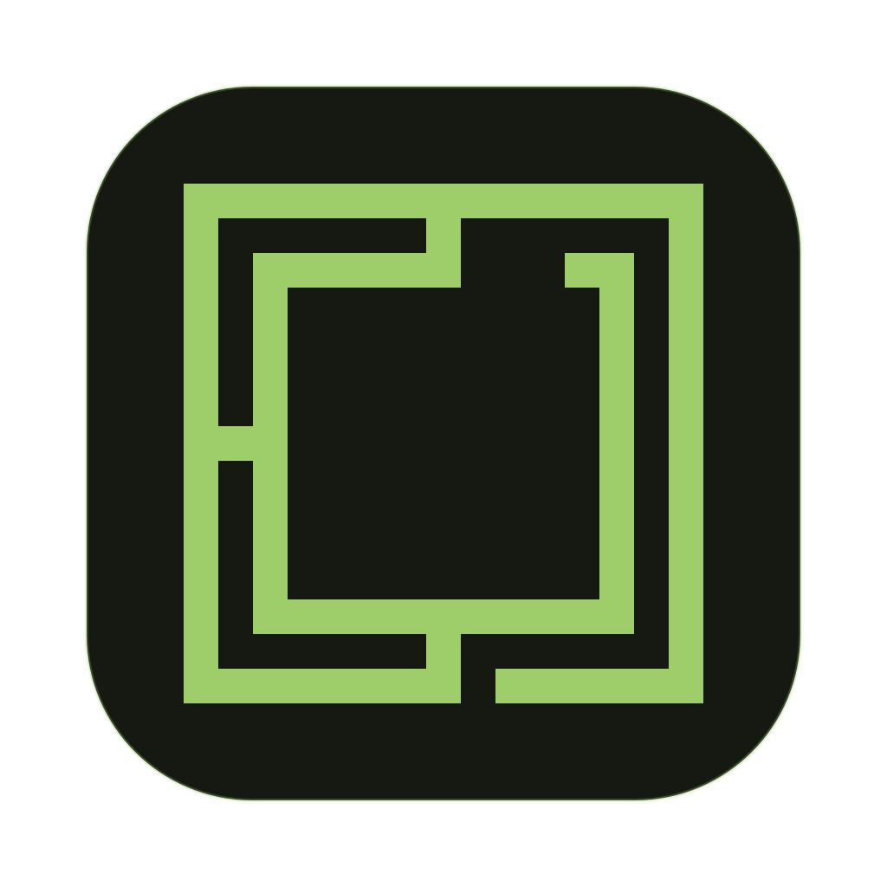
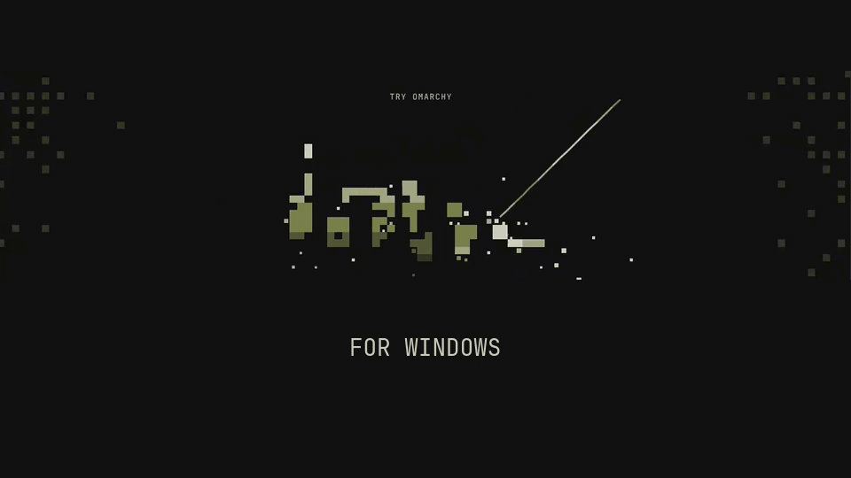

<p align="center">
  
</p>

<h1 align="center">Try Omarchy for Windows</h1>

**7Wdev development fork:** [build and upstream sync](https://github.com/7Wdev/try-omarchy-windows/blob/windows-nvgpu-lab/docs/FORK.md) ·
[NVIDIA development PR #2](https://github.com/7Wdev/try-omarchy-windows/pull/2).
The experimental QEMU/WHPX bridge renders the shipped Omarchy wallpaper, bar
and three readable applications on NVIDIA at **3840×2160**, through QEMU SDL.
Normal launcher integration and a stable interactive desktop remain in development.

[Daily-use readiness and remaining product checks](https://github.com/7Wdev/try-omarchy-windows/blob/windows-nvgpu-lab/docs/DAILY-USE-READINESS.md).


**Host display incident — November 3, 2026:** the user reports brightness and
graphics corruption across Windows; NVIDIA driver-reset events are recorded.
GPU/VM tests on this host are on hold. Cause and recovery remain unverified;
work continues through source and CPU-only checks. **Daily use is blocked.**
[Incident observations and limits](docs/HOST-DISPLAY-INCIDENT-2026-11-03.md).

**Uploader failure follow-up — November 4, 2026:** CPU fault injection
reproduces lost references and duplicate releases in the pinned Mesa uploader.
The ownership patch passes ten cases. A separate state-tracker guard prevents
null constant uploads in 216 CPU failure cases, with successful copies and
CPU retries preserved. Full runtime, Quickshell and hardware validation remain open.
[Patch, CPU evidence and limits](docs/MESA-UPLOAD-FAILURE-LIFETIME.md).
[Constant-buffer guard and limits](docs/MESA-CONSTBUF-FAILURE-GUARD.md).

**Source-only shutdown follow-up — November 4, 2026:** retirement now polls
the owned graphics thread before joining, and the relay command/state pair
shares one bounded deadline. CPU controls and both Windows owner compilations
pass; the owners are never executed. GPU/VM testing remains on hold.
[Changes, CPU evidence and remaining limits](docs/RETIREMENT-POLLING-AND-QMP-DEADLINES.md).

**Normal-session diagnostic — November 3, 2026:** run 10 records 176 native
4K handoffs with a clean terminal prompt. Quickshell crashes during a Mesa
constant-buffer copy; the return to VGA stalls and containment forcibly stops
QEMU. Complete desktop, cleanup and daily use remain unverified; counts stay
**4/8, 0/4, 3/3**.
[Actual frame, captured stacks and tested limits](docs/NORMAL-SESSION-CRASH-DIAGNOSTIC-2026-11-03.md).

**Normal-session retirement follow-up — November 2, 2026:** the diagnostic
PID-file collision is removed from normal-session lifetime. Run 8 records
**432 native 4K GPU handoffs** and same-process actor retirement, but socket
resets and terminal draining still fail. No complete scene is captured and
daily use remains unverified. Counts stay **4/8, 0/4, 3/3**.
[Exact changes, CPU controls and retained failures](docs/NORMAL-SESSION-RETIREMENT-WITNESSES.md).

**Normal-session frame transport — November 2, 2026:** the provisioned-account
session completes 61 native 4K GPU handoffs through the boot-console transition.
The actual capture contains only background/cursor, and shutdown fails. Full
wallpaper/application scenes and daily use remain unverified. Both strict host
builds and 135 CPU controls pass. Counts stay **4/8, 0/4, 3/3**.
[Actual capture, fixes and retained failures](docs/NORMAL-SESSION-FIRST-GPU-FRAMES.md).

**Native renderer selection — November 2, 2026:** the normal session's factory
adapter excludes boot VGA from desktop rendering. The complete library builds
and 17 factory controls pass; guest/GPU integration remains unverified. Counts
stay **4/8, 0/4, 3/3**. [Exact source and controls](docs/NATIVE-SESSION-RENDERER-SELECTION.md).

**Native boot console — November 2, 2026:** a rebuilt QEMU passes seven stopped,
windowless console controls. CPU ownership/redraw controls, actual launcher
argument checks and both strict host builds pass. Normal GPU boot and the real
display transition remain unverified.
Desktop acceptance remains **0/4**. [Implementation and tested limits](docs/NATIVE-BOOT-CONSOLE.md).

**Root session service — November 2, 2026:** owner-aware admission, broker
activation and cleanup now pass real CPU/IPC controls. Native service tools
compile and a unit is provided; normal GPU boot and recovery remain unverified.
Desktop acceptance remains **0/4**.
[Implemented service, exact controls and remaining work](docs/ROOT-SESSION-SERVICE.md).

**Normal-session startup boundary — November 2, 2026:** the persistent hook
now leaves watchdog information queries alone. A compositor exec wrapper
passes real credential/pidfd controls, and the staged desktop entry retains
the normal watchdog. Root activation and actual normal GPU login remain open.
[Exact startup contract, controls and remaining work](docs/NORMAL-SESSION-STARTUP.md).

**Persistent compositor source — November 1, 2026:** a separate opt-in hook
preserves normal Hyprland arguments and submits damage-driven frames without
a finite workload. CPU controls and a complete pinned Aquamarine build pass;
normal-session GPU integration remains unverified. Counts stay **4/8, 0/4, 3/3**.
[Implementation, CPU/build evidence and remaining integration](docs/PERSISTENT-COMPOSITOR-SESSION.md).

**Guest broker lifetime — November 1, 2026:** a root-supervised mode permits
rolling connections while preserving four/eight active-worker bounds. Real IPC
controls and the matched 1,800-handoff 4K three-app regression pass. The guest
session remains diagnostic; timing rises to 85.1 seconds against the 90-second
deadline, so performance stability remains open. Counts stay **4/8, 0/4, 3/3**.
[Exact scope, evidence and remaining product work](docs/ROOT-BROKER-SESSION.md).

**Host session transport — November 1, 2026:** an explicit launcher-owned mode
permits idle connections while retaining absolute message deadlines and cleanup.
Both strict builds, real socket cancellation/backpressure controls and the full
1,800-handoff 4K three-app regression pass. The guest still has diagnostic limits;
normal persistent sessions and daily use remain open. Counts stay **4/8, 0/4, 3/3**.
[Implementation, hardware evidence and exact limits](docs/LAUNCHER-HOST-SESSION.md).

**Original launcher profile — November 1, 2026:** the bounded three-app workload
now passes **1,800 GPU handoffs in 58.18 seconds**, exact first/final **3840×2160**
source/SDL pixels, authenticated native work for both Chromium GPU processes and
Nautilus, and live cleanup. Retained tab, producer-lifetime and diagnostic failures
have targeted fixes and CPU controls. Normal account startup, launcher activation,
physical input, sustained daily use and matched-native performance remain open.
Tests use inactive private desktops without host input. Counts stay **4/8, 0/4, 3/3**.
[Actual desktop and shader images, source changes and tested limits](docs/ORIGINAL-PROFILE-APPLICATIONS.md).
[Argument and ownership contract](docs/ORIGINAL-LAUNCHER-GPU-PROFILE.md).

**Go supervisor boundary — October 29, 2026:** prepared native owners now use
verified QEMU PID publication, cancellation and held-process exit checks in the
launcher supervisor. Hidden pressure/4K GPU and early lifecycle controls pass.
The normal guest argument/runtime profile and user activation remain incomplete;
counts stay **4/8, 0/4, 3/3**. [Implementation and tested limits](docs/GO-NATIVE-GPU-SUPERVISION.md).

**Native launcher lifetime — October 29, 2026:** the bridge publishes a verified
QEMU identity and reaps its owned VM on cancellation or creator exit. Three hidden
GPU regressions retain the original data/pixel and cleanup checks. Go launcher
activation, recovery during rendering and daily-use stability remain open;
counts stay **4/8, 0/4, 3/3**. [Protocol and tested limits](docs/NATIVE-LAUNCHER-LIFETIME.md).

**Vulkan buffer pressure — October 29, 2026:** two fresh guests recover from a
real allocation refusal, retry the same 64 MiB GPU buffer and complete both
original GPU data rounds with cleanup before VM exit. FD edge controls and the
original 4K compute/shader regressions pass. This is advisory allocation preflight;
concurrent pressure and full desktop stability remain open. Counts stay
**4/8, 0/4, 3/3**. [Exact recovery scope and retained failures](docs/VULKAN-GPU-PRESSURE-RECOVERY.md).

**Vulkan GPU data sharing — October 28, 2026:** four fresh guests pass both
complete 64 KiB GPU export/free/import/readback rounds with typed Windows buffer
metadata, including FD zero and FD-exhaustion recovery. The GPU corruption control
is rejected, and both original 4K workloads pass. Earlier ownership, import,
wait-hang and broker-profile failures remain retained. Daily use stays open;
counts remain **4/8, 0/4, 3/3**.
[Exact GPU data scope and retained failures](docs/VULKAN-GPU-BUFFER-ROUNDTRIP.md).

**Vulkan buffer sharing — October 28, 2026:** two fresh guests each pass 32
distinct FD exports and descriptor lifetime after the creator's memory is freed.
Native buffer admission and Linux Dozen FD ownership fixes retain their failure
controls; both 4K compute rounds still pass. Subsequent scoped GPU import/readback checks are recorded above. Vulkan windows
and daily-use stability remain open; counts stay **4/8, 0/4, 3/3**.
[Exact buffer/FD scope and controls](docs/VULKAN-MEMORY-FDS.md).

**4K Vulkan compute — October 28, 2026:** two fresh guests each pass two GPU
shader rounds with all **8,294,400 words per round** checked. A deliberately
corrupted final word is rejected. The original allocation refusal and its
reservation-recovery failure remain retained. Vulkan windows, broader apps,
recovery and daily-use acceptance remain open; counts stay **4/8, 0/4, 3/3**.
[Exact compute scope and controls](docs/VULKAN-4K-COMPUTE.md).

**Background synchronization — October 28, 2026:** six real GPU wait controls
pass with all 69 notifications released. Original Dozen reaches Vulkan device
creation and idle. A process-exit control still retains native mappings until
VM shutdown; GPU-backed Vulkan windows and daily-use stability remain open.
Shader coverage is recorded in the separate 4K compute follow-up above.
[Wait tests and retained recovery failure](docs/BACKGROUND-ASYNC-GPU-WAITS.md) ·
[Vulkan bring-up scope](docs/VULKAN-DEVICE-BRINGUP.md). Counts stay **4/8, 0/4, 3/3**.

**Three GPU applications — October 27, 2026:** a private integration completes
**1,800 handoffs** with Nautilus, sandboxed Chromium and the terminal visible
together. Complete first/final 4K source-to-SDL pixels, browser interactions,
resize, close/reopen and live cleanup pass. An explicit allocation-metadata
agreement clears the observed 1,024-record limit; byte budgets stay fixed.
Ordinary input/latency, longer sessions and normal launcher integration remain
open. [Actual three-app frame and retained failures](docs/APPLICATION-OBJECT-CAPACITY.md).

**Background shader validation — October 27, 2026:** paired original/sampled
guest shims render two real **3840×2160 NVIDIA shader frames** each, with complete
independent pixel checks, native GPU handoff and live cleanup. No window or input
route is requested. The sampled diagnostics produce identical images with fewer
reads; performance and desktop acceptance remain open.
[Actual 4K shader image and precise scope](docs/BACKGROUND-4K-SHADERS.md).

**Application-memory checkpoint — October 26, 2026:** an explicit owner/controller
agreement admits a shared 4 GiB GPU-usage pool after native headroom checks.
The public-source 4K desktop passes **1,800 handoffs**, full pixels, input response,
application replacement and live cleanup. A separate default-off regression
retains eviction/reuse coverage; the larger-pool workload has zero evictions.
That regression clears the old browser memory boundary; the later browser-frame
observation is recorded below.
[Actual frame, retained failures and precise coverage](https://github.com/7Wdev/try-omarchy-windows/blob/windows-nvgpu-lab/docs/APPLICATION-MEMORY.md).

**Memory-pressure checkpoint — October 26, 2026:** an owner-only admission pilot
refuses an observed Chromium allocation before native residency, avoiding the
forced VM stop in one repeat. The browser still fails; live desktop recovery
remains unverified. Default-off and enabled 4K desktop regressions pass.
[Actual frame, policy limits and retained failures](https://github.com/7Wdev/try-omarchy-windows/blob/windows-nvgpu-lab/docs/MAPPED-RESIDENCY-ADMISSION.md).

**Application compatibility checkpoint — October 25, 2026:** explicit process and
buffer agreements clear Chromium's four-process and sixteen-buffer boundaries.
A new legacy desktop regression passes **1,800 4K GPU handoffs**, complete pixels
and live cleanup. Chromium now passes those admission checks but still times out
during navigation; browser rendering and daily use remain unverified.
[Actual desktop frame, retained browser failures and next boundary](https://github.com/7Wdev/try-omarchy-windows/blob/windows-nvgpu-lab/docs/GUEST-BROWSING-PROGRESS.md#application-capacity-follow-up).

**Networking checkpoint — October 25, 2026:** the read-only guest now passes
DNS and certificate-verified HTTPS, then completes **1,800 4K GPU handoffs**
with complete pixels, application relaunch and live cleanup. Chromium's first
GPU initialization attempt fails and remains unaccepted.
[Actual networked frame and browsing status](https://github.com/7Wdev/try-omarchy-windows/blob/windows-nvgpu-lab/docs/GUEST-BROWSING-PROGRESS.md).

**GPU browser lifecycle — October 27, 2026:** the private integration completes
**1,800 GPU handoffs**, terminal typing/cursor response, resize/focus checks and
browser close/reopen. Both Chromium sessions display a public HTTPS page and
NVIDIA shader with **GPU compositing enabled** and all **17 observed GPU threads
sandboxed**. Complete first/final 3840×2160 source-to-SDL pixel checks and live
cleanup pass. The test startup synchronization changed; the official input
implementation did not. Ordinary browsing, normal launcher integration,
pressure recovery and daily-use acceptance remain open. Counts stay unchanged.
[Actual final frame, retained failures and exact remaining work](docs/GPU-BROWSER-LIFECYCLE.md).
The floating-layout follow-up also passes all **1,800 handoffs** and displays
the shipped wallpaper alongside readable Chromium and terminal windows.
The next **1,800-handoff** trial passes controlled browser wheel scrolling,
text insertion and tab open/close in both sessions through owned CDP pipes,
while preserving the GPU process, shader and compositing. Official browser
input/latency and daily use remain unaccepted.
[Actual browser interaction frame and precise scope](docs/GPU-BROWSER-INTERACTIONS.md).
The resize follow-up passes **1,800 handoffs** and both sessions' actual window
and viewport resize/restore checks with the NVIDIA shader preserved. Ordinary
Windows/SDL browser input remains unaccepted after a retained UI-observation
failure. [Actual post-resize frame and exact evidence](docs/GPU-BROWSER-RESIZE.md).

**Native GPU health — October 25, 2026:** the published-runtime build completes
**5,786 real device-health queries and 1,800 GPU handoffs**, including application
close/relaunch, complete source/SDL pixels and live cleanup. Native errors and
fault states are preserved. A separate private rollback experiment crossed the
1 GiB guard and failed; it remains excluded. Progress counts stay unchanged.
[Actual frame, validation and retained failure](https://github.com/7Wdev/try-omarchy-windows/blob/windows-nvgpu-lab/docs/GPU-DEVICE-EXECUTION-STATE.md).

**Residency recovery investigation — October 24, 2026:** a controlled
single-allocation refusal recovered through 1,800 GPU handoffs, but a
four-allocation repeat caused device loss. That runtime candidate stays
unpublished. The failure is retained with 16 replay checks; private paging-queue
research continues and progress counts stay unchanged.
[Actual frame, rejected candidate and next check](https://github.com/7Wdev/try-omarchy-windows/blob/windows-nvgpu-lab/docs/LIVE-RESIDENCY-ROLLBACK-INVESTIGATION.md).

**Verified metadata checkpoint — October 24, 2026:** immutable metadata requests fall
from **54 to 12 across six controlled validations**, while mutable counters
stay fresh. A new **1,800-handoff 4K GPU desktop regression** passes complete
pixels, two application windows, input response, resizing and live cleanup.
Atomic diagnostic receipts fix a real journal-prefix collision. Rendering
speedup and memory-pressure recovery remain unverified; two earlier pressure
failures stay rejected. [Actual frame, retained failures and exact scope](https://github.com/7Wdev/try-omarchy-windows/blob/windows-nvgpu-lab/docs/LIVE-METADATA-AND-TRACE-FRAMING.md).

**Earlier two-window checkpoint — October 23, 2026:** two fresh guests each pass
**1,800 GPU handoffs with two application windows**, complete 4K source/SDL
pixels, four focus checkpoints, changing counters and clean live teardown.
Explicit profile 14/v9 opts into a **384 MiB aggregate CPU mapping guard**;
older agreements retain their limits and the GPU usage guard stays 1 GiB.
An earlier **16-reference admission failure remains unresolved**.
[Actual two-window frame, all attempts and limits](https://github.com/7Wdev/try-omarchy-windows/blob/windows-nvgpu-lab/docs/LIVE-MULTIAPP-CPU384.md).

**Recovery follow-up:** valid capacity refusals now preserve the broker
connection. Two fresh guests now recover from an explicitly injected
**guest-side, pre-native refusal**, retry the same GPU resource, and pass
**1,800 handoffs** with complete pixels, input/resize response and live cleanup.
Actual native quota-refusal recovery and the intermittent reference-limit cause
remain open. [Actual post-fault frame, all attempts and precise scope](https://github.com/7Wdev/try-omarchy-windows/blob/windows-nvgpu-lab/docs/LIVE-INJECTED-ALIAS-GPU-RECOVERY.md).

**Verified pressure checkpoint — October 22, 2026:** two fresh guests exceed **2 GiB of
GPU virtual mappings**, verify 56 GPU copy/evict cycles and retained contents,
then each pass **1,800 desktop handoffs over 35.3 and 34.5 seconds**. Complete
4K source/SDL pixels, rendered input response, lifecycles, resizing and live
cleanup pass. The reported resident-memory and CPU mapping guards are unchanged.
Longer pressure while rendering remains open.
[Actual frame, diagnostic scope and verification limits](https://github.com/7Wdev/try-omarchy-windows/blob/windows-nvgpu-lab/docs/LIVE-GPU-VA-PRESSURE.md).

**Product priority: preserve the official keyboard/cursor code and QEMU SDL
input path, including the launcher's reserved-key routing.** The GPU relay uses
that frontend's input implementation. Physical-input acceptance and normal
launcher integration remain open. [Verified source map](https://github.com/7Wdev/try-omarchy-windows/blob/windows-nvgpu-lab/docs/UPSTREAM-INPUT-GRAPHICS-INTEGRATION.md).


Actual **2560×1566 SDL pre-swap backbuffer** from a complete 3840×2160 GPU source.
Physical 4K scanout remains unverified. The test uses a disposable UWSM/PAM
account and RAM overlay over a read-only source disk. The released launcher
continues using the upstream graphics runtime.

| Progress measure | Verified status | What remains |
| --- | --- | --- |
| 4K diagnostic scene | **3/3:** shipped wallpaper, Omarchy bar, readable GPU applications | Normal launcher and usable desktop acceptance. |
| Bounded NVIDIA rendering through QEMU SDL | **Two simultaneous-window repeats:** 1,800 handoffs, complete pixels/input response, four focus checkpoints and live cleanup | Intermittent reference failure/recovery, long-run pressure, displayed cadence and official physical input. |
| Backend verification | **4/8 stages demonstrated** | Supported device integration, broader APIs, recovery and performance. |
| Desktop product acceptance | **0/4 gates complete** | Normal account/launcher, continuous multi-window use, reliability and matched-native performance. |

The address-accounting agreement separates owned reservation mappings from
resident memory. The new bounded diagnostic exercises the extended virtual
boundary before the desktop stream, with an independent retained-content
oracle. It adds explicit diagnostic upload/readback and no shader or performance
acceptance. The default residency path and earlier failed controls are retained.

Required targets include broad **OpenGL, Vulkan, CUDA, video acceleration, DLSS,
hardware ray tracing** and **≥93% matched-native performance**, including concurrent
Windows/guest workloads. Each needs actual application or SDK acceptance.
CPU handoff intervals do not establish displayed FPS or native performance.
[Gate definitions and evidence history](docs/GPU-BACKEND-PROGRESS.md) ·
[Driver-update matching](docs/LIVE-SUSTAINED-NVIDIA-DESKTOP.md) ·
[Virtio trace/UART comparison](docs/LIVE-VIRTIO-GRAPHICS-TRACE.md).

Download links below refer to official upstream releases.

<p align="center">The full Omarchy desktop, running in a window on your Windows PC.</p>

<p align="center">
  <strong><a href="https://github.com/omacom/try-omarchy-windows/releases/latest/download/TryOmarchy.exe">Download TryOmarchy.exe</a></strong>
  &nbsp;·&nbsp; <a href="https://github.com/omacom/try-omarchy-windows/releases/latest/download/TryOmarchy.exe.sha256">SHA256</a>
  &nbsp;·&nbsp; <a href="https://github.com/omacom/try-omarchy-windows/releases/latest">Latest release</a>
</p>

<p align="center">Windows 10 or 11 · x86_64 · Hardware virtualization required</p>

<picture>
  <source media="(prefers-reduced-motion: reduce)" srcset="docs/images/try-omarchy-windows-still.jpg">
  
</picture>

Try Omarchy runs [Omarchy](https://omarchy.org) in a virtual machine. You can explore its apps, themes, and keyboard-first workflow without repartitioning your drive or leaving Windows. Your Linux files persist between sessions.

<a id="try-it"></a>

## Get started

1. **Download and open [TryOmarchy.exe](https://github.com/omacom/try-omarchy-windows/releases/latest/download/TryOmarchy.exe).** The launcher is about 10 MB and is signed by Brandon South. You can check the signature in the file's **Properties > Digital Signatures** tab.
2. **Choose where to keep Omarchy.** The default is `%LOCALAPPDATA%\TryOmarchy`. Setup may enable Windows Hypervisor Platform and request one restart.
3. **Set up your own account, or pick the quick start.** Your own account is the default. The app then downloads and verifies the graphics runtime and guest image, about 2 GB in total, and starts Omarchy. Omarchy's setup asks for your username and password; the quick start skips that form and signs in as `omarchy` / `omarchy`. Once the desktop opens, press **Super+Space** for the Omarchy menu and **Super+K** to see the keybindings.

See the [user guide](docs/USER-GUIDE.md) for updates, shortcuts, storage, settings, and removal.

## What you can do

- **Use the whole desktop.** Hyprland, Omarchy's apps, themes, menus, notifications, and screensavers run inside the window.
- **Move between Windows and Omarchy.** Share text, images, files, and folders through the clipboard and the optional shared folder. Drop Windows files onto an open Files folder or onto an app, such as a browser upload area.
- **Use your hardware.** Supported graphics drivers can render through VirGL and Venus Vulkan. The launcher falls back to CPU rendering when that path is unavailable.
- **Make it yours.** Choose a display, audio devices, resource profile, and optional fullscreen or direct-launch shortcuts. Windows Hello for guest `sudo` is available for personalized accounts.
- **Keep your work.** The guest disk persists, with backup, restore, reset, and update controls.
- **Take it with you.** When you install Omarchy for real, one command brings your settings, apps, files, and projects over from the trial. See [moving to a real install](docs/MIGRATION.md).

[Watch the Windows demo](https://tryomarchy.com/images/try/windows.mp4) or read the [compatibility guide](docs/COMPATIBILITY.md) for the current hardware and application limits.

## Before you start

- You need a **64-bit Windows 10 or 11 PC** with hardware virtualization enabled. ARM64 Windows PCs are not supported.
- Standard installs use a local **NTFS or ReFS** drive. The guest and downloads live in the folder you choose. First setup downloads the guest image and a portable graphics runtime.
- GPU acceleration depends on the Windows GPU, driver, and bundled runtime. CPU rendering remains available. This is a virtual GPU, not physical GPU passthrough; check [graphics and app limits](docs/COMPATIBILITY.md) for specific workloads.
- Keep important guest files backed up outside the VM. [Backups](docs/BACKUP.md) and [moving an installation](docs/MOVING.md) are documented separately.

## Guides

- [Guide index](docs/README.md): find help for a specific task
- [Using Try Omarchy](docs/USER-GUIDE.md): setup, keys, settings, storage, updates, SSH, and troubleshooting
- [Compatibility](docs/COMPATIBILITY.md): supported hosts, graphics paths, and app limits
- [Windows desktop controls](docs/DESKTOP-CONTROLS.md): display, input, and host integration
- [Guest upgrades](docs/GUEST-UPGRADES.md), [backups](docs/BACKUP.md), and [moving your data](docs/MOVING.md)
- [Changelog](CHANGELOG.md) and [releases](https://github.com/omacom/try-omarchy-windows/releases)
- [Contributing](CONTRIBUTING.md): repository layout, build, and test instructions

If something goes wrong, use **Create diagnostics...** in the tray and [open an issue](https://github.com/omacom/try-omarchy-windows/issues/new/choose). The [user guide](docs/USER-GUIDE.md#reporting-a-problem) explains what it contains.

## Under the hood

Try Omarchy uses QEMU on the Windows Hypervisor Platform, an x86_64 Arch guest image, and the [WINQ-EMU](https://github.com/cmspam/winq-emu) graphics runtime. The Go launcher handles setup, updates, VM supervision, and Windows integration. See the [technical findings](docs/FINDINGS.md), [runtime build](runtime-build/README.md), [guest build](guest-build/README.md), and [release process](docs/RELEASING.md).

To build the launcher with Go, run:

```sh
git clone https://github.com/omacom/try-omarchy-windows
cd try-omarchy-windows/app
GOOS=windows GOARCH=amd64 go build -trimpath -ldflags "-H windowsgui -s -w" -o TryOmarchy.exe .
```

## Credits and license

Try Omarchy for Windows builds on [Omarchy](https://github.com/basecamp/omarchy), Eduardo's original Try Omarchy app, Jorge Silva's [Windows guest builder](https://github.com/jorge-huxley/try-omarchy-win), [WINQ-EMU](https://github.com/cmspam/winq-emu), and [Chainfire's Windows GPU work](https://github.com/Chainfire/omarchy-windows-hyperv-gpu). Thanks to the [dockur/windows](https://github.com/dockur/windows) project for the Windows development environment.

Scripts and documentation in this repository are [MIT licensed](LICENSE). Omarchy and the guest image carry their own licenses; see the [third-party notices](THIRD_PARTY_NOTICES.md). The app icon uses the [official Omarchy mark](https://omarchy.org/brand/), which remains subject to Omarchy's trademark rights.

Looking for the Mac version? See [Try Omarchy for macOS](https://github.com/omacom/try-omarchy).
