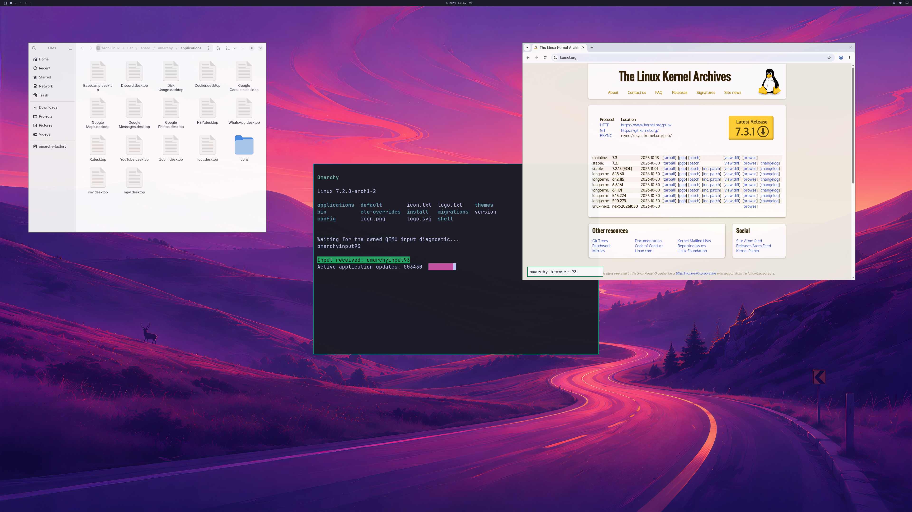

# Original-profile GPU regression and diagnostic retention

**Latest November 1 follow-up:** bounded run 30 passes 1,800 handoffs in
58.177667 seconds, exact first/final 4K pixels, authenticated native work for
both Chromium GPU lifetimes and Nautilus, and live cleanup. Tab retirement,
producer lifetime and coherent diagnostic-output fixes retain earlier failures.
Normal sessions, launcher activation, physical input, long sessions and daily
use remain open; counts stay **4/8, 0/4, 3/3**.
[Current desktop/shader captures and precise proof](ORIGINAL-PROFILE-APPLICATIONS.md).
The older observations below retain their original scope.

**November 1, 2026:** private run **25** completes the unchanged **1,800-frame,
90-second** workload through the original launcher argument profile in
**59.064 seconds**. Authenticated compositor END and drained-output ACK both
report frame 1,800. Every native handoff is ordered and GPU backed; the complete
first and final **3840×2160** source and SDL backbuffer comparisons have maximum
channel error **zero**. Native submissions and tracked cleanup pass.

This is a bounded engineering regression. Normal account startup, released
launcher activation, physical Windows input, sustained daily use and matched
native performance remain unverified. Backend/product/scene counts stay
**4/8, 0/4, 3/3**. The earlier deadline failure remains recorded below.

The PNG is a lossless encoding of actual GPU output, visually inspected without
editing its pixels. It shows the shipped wallpaper and three readable application
windows. The public page and its contents are incidental to this captured run.

## Source changes

`guest_bridge_log.h` adds an explicit `WDDM_BRIDGE_VERBOSE_IOCTL_TRACE=0`
compile-time profile. The default remains `1`, preserving verbose behavior.
Quiet mode suppresses only inspected routine record names before journald.
Unknown, status, error, refusal, timeout and unsupported-operation formats remain.
The logging function evaluates all arguments, including existing fence/MMIO
reads. An aggregate suppression count is emitted during bridge teardown.
No IOCTL, rendering, ordinary fence-wait or input behavior is replaced.

The diagnostic guest supervisor collects separate JSON snapshots for the
compositor session, application controller, browser records, journald losses
and the last queue-timing samples. Limits are **160 / 160 / 96 / 16 / 64** rows
with the existing five-second child deadline per query. Full JSON values and
PID/UID/unit/boot/cursor metadata are requested; color and hyperlink controls
are disabled. Journal storage and rate limits are unchanged. These are line
limits, not a general output-byte cap or a complete-stream ordering proof.

A read-only snapshot of the terminal's existing progress file is limited to
**512 bytes**. Symlinks, nonregular files, unexpected owners, empty/oversize data
and observed concurrent changes fail. FIFO opens are nonblocking. The contents
remain user-authored diagnostic data; file ownership does not independently
attest the producer process. The producer's 3,600-update bound is unchanged.

## Verified run-25 scope

| Observation | Result |
| --- | ---: |
| Ordered GPU handoffs, authenticated END and ACK | 1,800 |
| Controller elapsed time / unchanged deadline | 59.064241 / 90 seconds |
| Complete source and SDL first/final captures | 3840×2160 each |
| Maximum channel error in both full pixel comparisons | 0 |
| Native submissions / failures / timeouts | 4,406 / 0 / 0 |
| Device-health queries / failures | 4,832 / 0 |
| Peak allocation records / limit | 1,063 / 2,048 |
| Peak reported GPU usage / pool | 1,355,952,128 / 4,294,967,296 bytes |
| Source image and installed NVIDIA driver changed | No |
| Native resources or mappings retained after VM exit | 0 |
| Owned job processes after cleanup | 0 |
| Private desktop closed; working desktop untouched | Yes |

The hardware is an RTX 5090 Laptop GPU, NVIDIA 621.01. The original four-vCPU,
6 GiB guest profile and all four original QMP roles remain. The existing
33-command fixture sends input to the guest's original tools endpoint; it sends
no host input. This preserves the official SDL route but does not test physical
Windows keyboard/mouse delivery. The source disk is held read-only.

The collector retains both browser lifetimes' shader, sandbox, HTTPS page and
retirement records, four browser/GTK checkpoints, two browser interaction proofs,
four browser resizes and three terminal resizes. Full application acceptance is
still **open**: the filtered UART does not retain the old oracle's per-process
`nativeCommandQueued` records. Browser self-reports, correct desktop pixels and
aggregate native submission counts do not replace that correlation requirement.

For the last **63 ordinary, nonaudit frames**, queue round-trip CPU wall time has
median **0.8953 ms**, p95 **4.2283 ms**, maximum **4.8457 ms**. These are tail
samples, not full-run latency, GPU timestamps, scanout cadence or a native
performance comparison. The final audit copy takes longer and is excluded from
those ordinary-frame statistics. No 93%-of-native claim follows from this run.

## Retained failures and limitations

| Attempt | Retained outcome |
| --- | --- |
| 22 | Native 1,800 handoffs and exact 4K pixels, but 37,050 journald-suppressed messages and failed private-window enumeration; overall rejected |
| 23 | Private harness variable collision creates overlong QMP paths; rejected before guest boot, no graphics or input |
| 24 | Clean isolation and GPU teardown, both browser record sets retained, but only 1,454 workload frames in 90.026 seconds plus a later drain frame; rejected |
| 25 | 1,800 ordered handoffs, authenticated completion, exact first/final 4K pixels and clean isolation; full application/product acceptance remains open |

Run 25 changes only the collector binary from run 24. All other archive payloads,
entry metadata and padding are compared. Consequently, its successful timing
does not establish a rendering performance fix or explain run 24's variability.
The terminal finalized after run 24's deadline; its exit log alone does not prove
its pulse stopped early. No producer extension or repaint stimulation is used
to make the regression pass.

The private harness also has seven passing CPU controls, including Unicode and
window churn plus correctly rejected injected enumeration failures, with owned
job/desktop cleanup checked. Its earlier churn timeout and the unproven cause of
run 22's enumeration failure remain recorded. Host input is never injected.

Strict C11 compilation passes with both current public headers and the actual
legacy runtime closure; the original supervisor is reproduced byte for byte.
Three logger controls, fourteen named-port controls and the bounded-reader
control pass. The sampled quiet legacy shim separately reproduces its original
binary, compiles both trace profiles and passes fourteen real IPC/mapping
ownership/revocation controls. These CPU checks do not establish GPU readiness.

Remaining product gates include normal session flow, physical input acceptance,
responsive sustained browsing under repeatable load, bounded pressure/recovery
and interruption during rendering. General Vulkan window presentation, CUDA,
video acceleration, DLSS, hardware ray tracing and the requested matched native
performance target remain unverified.

Private source/driver binaries, disks, initrds and raw journals are not published.
The [public evidence summary](evidence/launcher-profile-run25-2026-11-01.json)
records immutable hashes and the limits of each proof.
