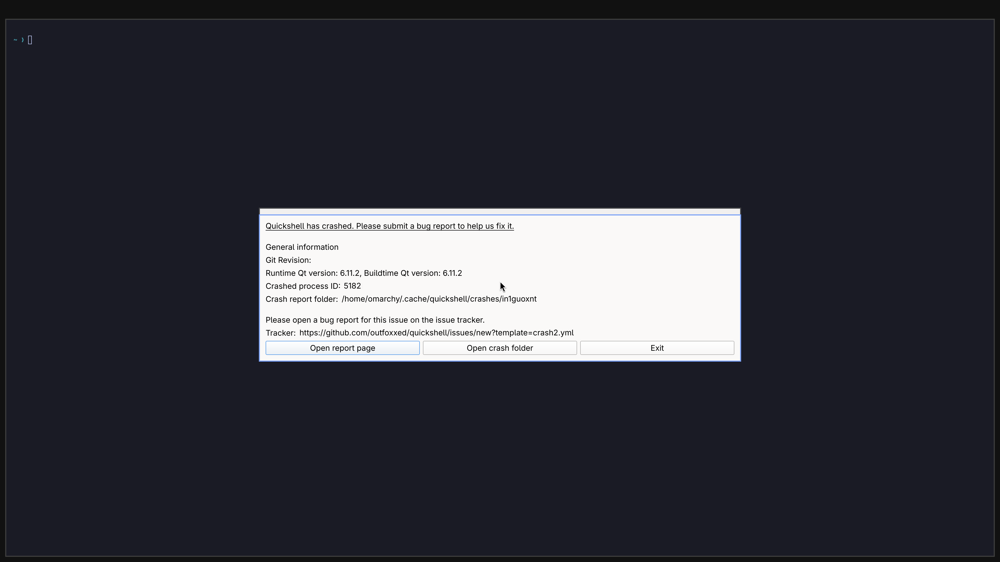

# Normal-session crash diagnostic: run 10

A later [host display incident](HOST-DISPLAY-INCIDENT-2026-11-03.md) blocks
readiness and further hardware tests on this host. The observations below
predate that incident and do not establish host driver stability.

The approved background run records **176 native 3840×2160 GPU handoffs**.
The terminal log flood is absent, but Quickshell still crashes and the return
to VGA does not complete. **Daily use remains unverified.** Counts remain
backend **4/8**, desktop **0/4**, diagnostic scene **3/3**.

The image is a guest `grim` capture. Every recorded handoff separately verifies
the NVIDIA root adapter, borrowed primary console, GPU channel conversion and
matching producer/consumer fences, with no CPU texture upload. This does not
prove source-to-SDL pixel equality, displayed FPS or physical input responsiveness.
All nine captured scene candidates fail the stronger session prerequisites.
Visual inspection confirms the readable prompt and crash dialog; wallpaper and
bar are not verified. A shell IPC reply alone is insufficient for acceptance.

## What changed in the diagnosis

Two independently collected Quickshell reports contain SIGSEGV stacks through
Mesa's `st_update_vs_constants`, `st_prepare_draw`, `_mesa_DrawElements` and Qt's
`QRhi::endFrame`. The exact installed Mesa library matches the image/build hash.
Three function ranges independently imply the same page-aligned module base in
each report. Both reports resolve to Mesa offsets `0x42a447`, `0x11ab1a` and
`0x30bb5c`. Disassembly places the first offset within the `memcpy` call following
`u_upload_alloc`, matching the uniform-data copy in `st_atom_constbuf.c`.

The reports do not contain the pointer/register values needed to establish
whether the destination is null, a mapping is invalid or another input is bad.
No rendering fix is claimed. Earlier EGL/RHI initialization warnings do not
fully describe these draw-time failures. Raw crash archives, binary logs and
guest journals remain private; only selected stack facts and hashes are public.

QEMU's new flushed trace reaches context activation, retirement fence completion,
scanout disable, GL object release, import-context deletion and entry into the
return to VGA. It never emits `complete`. The host reports a QMP wait failure
during retirement, then **forcibly stops the held QEMU process with code 90**.
This run does not establish a spontaneous QEMU crash or its exact blocking
instruction. The preceding run's `0xc0000005` remains a separate observation.

The host previously reported both a `select` timeout and a Winsock failure as
`QMP control socket failed`. The follow-up separates those outcomes, retaining
the existing deadlines, EOF handling and fail-closed ownership. This improves
diagnosis; it does not fix the stalled VGA return. The matched SDL 2.32.10
[deletion wrapper](https://github.com/libsdl-org/SDL/blob/release-2.32.10/src/video/SDL_video.c#L3974)
only unbinds the context being deleted when it is current. A blanket claim that
deleting an unrelated import context always clears the root context is unsupported.

## Tested limits

The six-minute containment limit is not exceeded. The held VM is reaped, its
owned job has zero remaining processes and the private desktop closes. The
input desktop never changes; no host or guest input is injected. Official
Windows input code is unchanged. The read-only base disk and installed NVIDIA
runtime hashes remain unchanged. These are containment checks, not proof of
successful GPU retirement or recovery.

The released launcher GUI, physical keyboard/mouse responsiveness, browsing,
multiple healthy application windows through 4K, sustained sessions and bounded
daily workloads remain unverified. Broad API coverage, video, CUDA, Vulkan,
DLSS, ray tracing and at least 93% matched-native performance also remain open.

[Structured evidence](evidence/normal-session-crash-diagnostic-2026-11-03.json) ·
[Previous run and access violation](NORMAL-SESSION-GPU-ATTEMPT-2026-11-03.md) ·
[Idle-preload change](IDLE-PRELOAD.md) ·
[Daily-use gates](DAILY-USE-READINESS.md).

[Source changes and offline controls](OFFLINE-SESSION-CONTROLS.md).
