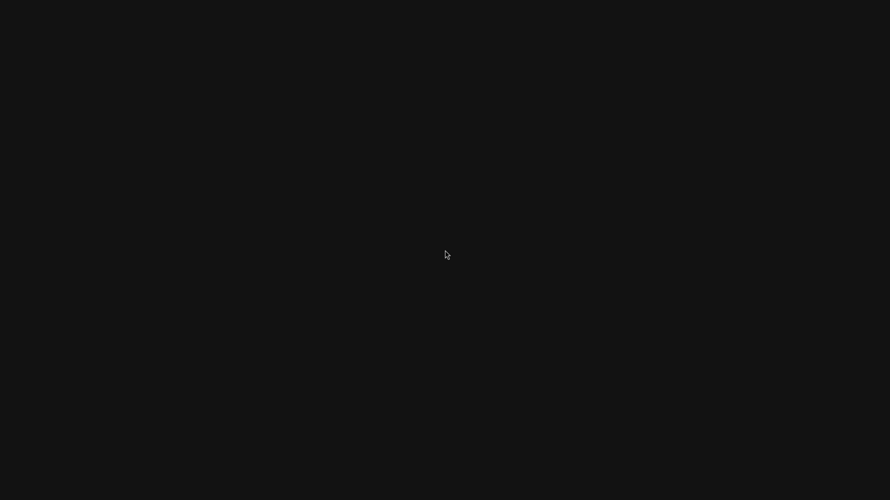

# First normal-session GPU frame transport

**November 2, 2026:** the official provisioned-account session now submits
**61 native 3840×2160 frames** through QEMU SDL after the boot-console handoff.
This proves the transport boundary. **The captured scene is only background
and cursor, and shutdown fails.** Wallpaper, application windows and daily-use
acceptance remain unverified. Counts stay **backend 4/8, desktop 0/4, scene 3/3**.

## Observed frame and scope

This is the unmodified guest `grim` screencopy from private run 7. A cursor makes
the image nonuniform; that alone does not establish a complete desktop. Complete
source-to-SDL pixel comparison and physical 4K scanout are not tested here.
The capture occurred while the shell was still initializing. Xwayland also
reports a software glamor fallback, so all-application GPU coverage is unaccepted.

The run follows official instant-account provisioning, SDDM/PAM, UWSM and the
retained watchdog through the compositor wrapper. It uses the real Go supervisor
boundary, an exported launcher argument profile and the explicit native boot
option. Test storage/paths, kernel command line, firmware and temporary loopback
SSH forwarding are recorded adaptations. The released launcher GUI is not
activated. Original Windows input code and input arguments remain unchanged;
no host or guest input is injected. All surfaces remain on an owned inactive
Windows desktop.

## Fixes and evidence

Run 5 isolates the earlier `ENODEV`: native buffer checks pass, but the initial
output commit has no current EGL display. The hook now consumes exactly one
validated startup buffer without creating a fence, queueing pixels or counting
a rendered frame. Repeated absence, absence after rendering starts and malformed
buffers still fail. No forced repaint, finite desktop workload or software
fallback is added.

Run 6 gets past that boundary but reveals a host phase mismatch: boot-console
attach intentionally leaves VGA active and has no native root-adapter proof yet.
The host now validates that specific pending state only for the explicit owned
boot mode. **The first native present still requires root-adapter verification**,
an active native console, the borrowed primary console and exact frame counters.
Detach validates the return to VGA. Accepted attaches remain tracked for ordered
teardown even if their state reply is subsequently rejected.

Run 7 then passes frames 1–61. Every returned state identifies the NVIDIA
adapter/LUID, primary borrowed console, active native console, successful GPU
BGRA conversion and exact monotonically increasing frame count. Independent
producer/consumer fences are used, with no CPU texture upload or ordinary CPU
fence wait. Both fences reach 61 before the shutdown failure. These are queued
and retired GPU observations, not displayed-FPS or near-native performance proof.

The exact source passes **58 hook, 43 wrapper and 34 root-service CPU controls**,
plus both complete strict Windows builds. The matched private image passes all
403 payload, 68 directory, 23 symlink, mode, ownership and gzip checks. The
proprietary package remains private.

[Later follow-up: normal witness policy, 432 GPU handoffs and retained shutdown failures](NORMAL-SESSION-RETIREMENT-WITNESSES.md).

## Retained cleanup failure and next work

Run 7 observes multiple Quickshell actors with the same process ID. A later
retirement fails writing its diagnostic PID-named witness after an earlier actor
for that PID retired successfully. The exclusive PID-file creation in the source
explains the collision; the exact syscall errno is not logged. Broker failure
prevents terminal presentation drain, then SDL detach encounters disconnected
QMP. The native owner exits 3 and the owned VM is stopped with exit 90. Successful
GPU cleanup is not claimed. Isolation contains all descendants; the source disk
and installed NVIDIA runtime hashes remain unchanged.

Next: separate diagnostic witnesses from normal broker lifetime, verify SDL
detach before VM exit, allow shell initialization to finish, and capture actual
wallpaper/layers and application windows. Ordinary input latency, responsive
browsing, sustained sessions, bounded resources, recovery, broad
CUDA/OpenGL/Vulkan/video support, DLSS, hardware ray tracing and **at least 93%
matched-native performance** remain open.

[Structured evidence, exact sources and retained failures](evidence/normal-session-first-gpu-frames-2026-11-02.json) ·
[Earlier boot attempts](NORMAL-SESSION-BOOT-ATTEMPTS.md) ·
[Daily-use acceptance](DAILY-USE-READINESS.md).
