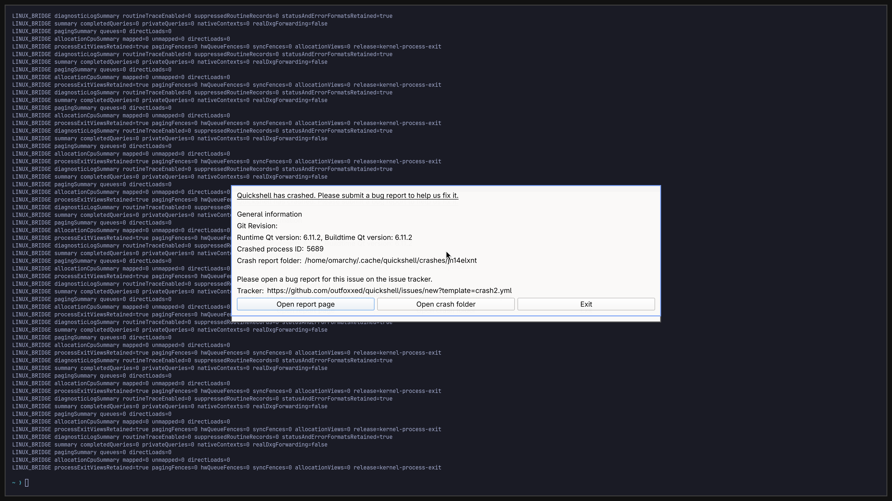

# Normal-session GPU attempt: terminal capture and retained failures

This page preserves run 9. The subsequent [run 10 diagnostic](NORMAL-SESSION-CRASH-DIAGNOSTIC-2026-11-03.md)
tests the trace and idle-preload changes, captures draw-time crash stacks and
records a stalled VGA return followed by forced containment.

**November 3, 2026:** the explicitly approved inactive-desktop test completes
**183 native 3840×2160 GPU handoffs** and reaches the trusted final group-cleanup
stage. A same-VM capture shows a readable Foot terminal and a **Quickshell crash
dialog**. QEMU exits with `0xc0000005` during retirement and SDL detach loses QMP.
**Complete desktop and cleanup acceptance remain open.** Counts stay backend
**4/8**, desktop **0/4**, diagnostic scene **3/3**.

## What the run establishes

The normal provisioned-account path follows SDDM/PAM/UWSM and its retained
watchdog through the compositor wrapper. It uses the existing Go supervision
boundary and original launcher argument profile with recorded private runtime,
storage, network and boot adaptations. The released launcher GUI is not used.
The matched image changes only the broker payload from the previous image;
independent archive checks pass. Both exact source CI checks pass before this
run. Neither CI nor the short run establishes readiness.

Frames 1–183 have matching producer/consumer fence observations, native NVIDIA
root-adapter verification, an active borrowed primary console and GPU BGRA
conversion. No CPU texture upload or ordinary CPU fence wait is reported.
These are transport observations, not displayed FPS, all-application hardware
acceleration, full source-to-SDL pixel equality or matched-native performance.

The broker reports no route failure or protocol rejection and reaches
`BROKER_COORDINATOR_GROUP_STOPPED`: workers are joined, the primary pidfd has
exited and the capability registry is empty. Native terminal retirement does
not complete. SDL still reports an attached output when QMP disconnects; both
fences had reached 183. The native owner exits 3 and QEMU exits `0xc0000005`.
That exit code is consistent with an access violation; the exact faulting
instruction and failing detach stage are not known. No new Windows crash dump
or matching application event is available. Successful GPU cleanup is unproved.

Containment reaps the held VM and leaves zero owned job processes. The inactive
desktop never becomes the input desktop, host and guest input are not injected,
and source disk and installed NVIDIA runtime hashes are unchanged. The test
ends within its six-minute bound. These containment checks do not establish
native resource cleanup or recovery.

## Scene observation and next fixes

The original scene check starts the installed Foot terminal, but its SSH
environment lacks `OMARCHY_PATH` and uses the wrong shell IPC target. A bounded
read-only check in the same held VM confirms the session path and helper usage.
A separate recorded correction supplies that path and calls `omarchy-shell
shell ping`, requiring the existing terminal marker so it cannot start another
terminal. The original harness remains unchanged. The corrected capture is the
unmodified guest `grim` image above.

Visual inspection rejects it as a complete healthy scene: wallpaper/bar are not
verified and Quickshell has crashed. The shell ping returned `ok` despite the
visible failure, so ping, a mapped app and nonuniform pixels are insufficient
scene acceptance checks. Retained journals show EGL initialization and
`QRhiGles2` context-creation failures. Unsupported escape warnings also occur in
the working compositor and do not, by themselves, prove the shell's root cause.
An attempted later crash-report read is refused by the held-process guard after
VM exit; it executes no guest command.

The follow-up source adds flushed stage markers only to QEMU's detach path:
context activation, retirement fence operations, scanout disable, GL object and
context release, VGA return and completion. Removing that diagnostic function
and its calls yields the previous source bytes exactly. The new diagnostics
were not present in run 9, have no presentation-path logging, and still require
a complete QEMU build and a separately authorized GPU run. They localize the
next failure; they are not a crash fix.

The [idle-preload follow-up](IDLE-PRELOAD.md) removes the zero-activity summary
spam from ordinary processes and passes CPU controls; VM integration is pending.

Next work is the QEMU retirement fault and Quickshell's actual EGL/RHI failure,
with a corrected session-aware scene check and earlier bounded crash collection.
Normal launcher activation, responsive input, browsing/multiple windows through
4K, sustained sessions, bounded resources, recovery, broad APIs, DLSS, ray tracing
and at least 93% matched-native performance remain open.

[Exact structured observations](evidence/normal-session-gpu-attempt-2026-11-03.json) ·
[Terminal scheduler implementation](TERMINAL-GROUP-RETIREMENT.md) ·
[Daily-use acceptance](DAILY-USE-READINESS.md).
