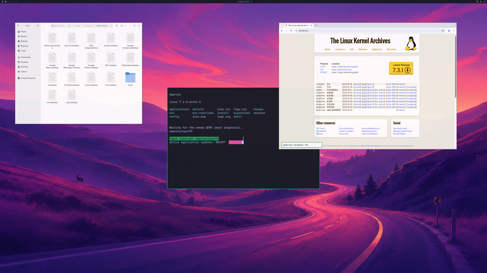

# Original-profile three-application GPU regression

**November 1, 2026:** run **30** passes the bounded **1,800-handoff** workload in
**58.177667 seconds**, through the original Go argument profile. Both Chromium
GPU lifetimes and Nautilus now have authenticated per-process native-work
summaries, live GPU quiescence and retirement. Complete first/final
**3840×2160 GPU source and SDL pixels match with maximum channel error zero**.

This closes the per-application correlation gap in run 25. Normal account/session
startup, released launcher activation, physical Windows input, sustained daily
use and the requested 93% matched-native performance remain open. Counts stay
**backend 4/8, desktop product 0/4, diagnostic scene 3/3**.

The lossless PNG contains actual, unedited GPU output. Its browser input field
and terminal response come from the bounded fixture. They do not prove physical
Windows input. The public page contents are incidental to this capture.

## Native work and application evidence

| Bounded run-30 observation | Result |
| --- | ---: |
| Ordered GPU handoffs and authenticated END/ACK | 1,800 |
| Native submissions / failures | 4,398 / 0 |
| Device-health queries / failures | 4,827 / 0 |
| Peak allocation records / limit | 1,068 / 2,048 |
| Peak reported GPU usage / pool | 1,363,136,512 / 4,294,967,296 bytes |
| First Chromium GPU PID 2299 / actor 9, accepted native commands | 90 |
| Reopened Chromium GPU PID 2892 / actor 12, accepted native commands | 71 |
| Nautilus PID 2601 / actor 10, accepted native commands | 9 |
| Three mapped apps at four checkpoints | Pass |
| Owned-CDP browser interaction proofs / GPU resizes | 2 / 4 |
| Terminal resizes / guest-only QMP commands | 3 / 33 |
| Natural VM exit and tracked native cleanup before exit | Pass |

Native `SubmissionActivity` is host-local diagnostic accounting. It increments
only after the existing reply validator accepts native status zero; errors,
malformed replies and replays do not count. Overflow marks counts inexact rather
than changing GPU admission. One summary is emitted when an empty actor releases.
No wire layout, guest capability, GPU call or official input implementation changes.

These counts establish **native queue acceptance**, not completion of each
individual command. The separate retirement checks require GPU quiescence; the
core audit also requires completed native submissions, fences, health queries,
ordered handoffs and zero tracked objects/mappings before exit. Aggregate work
alone cannot substitute for an application's authenticated actor.

Both Chromium sessions load certificate-verified public HTTPS, keep GPU
compositing and all observed GPU threads sandboxed, and retain the NVIDIA shader
through controlled scroll/text/tab operations and real viewport resize/restore.
Nautilus retains a realized `GskGLRenderer` at all four checkpoints. Browser
observer/keyring shutdown, close/reopen and live native retirement pass.

This **512×256** PNG is the browser's actual canvas export; both sessions produce
identical bytes. The separate GL readback returns **[128,128,64,255]**, error zero
and context not lost. Canvas export alone does not certify visible presentation;
the complete desktop pixel comparisons above provide the separate display proof.

## Retained failures and bounded fixture corrections

| Run | Outcome |
| --- | --- |
| 26 | Temporary-tab retirement check fails after 332 workload frames. Exact differing target IDs were not retained; asynchronous teardown is a hypothesis. Rejected. |
| 27 | Browser checks pass, but only 1,434 handoffs finish. The terminal reaches its original 3,600-update cap; its last update is 27.686 seconds before controller end. Rejected. |
| 28 | Full core, applications, pixels and producer inspection pass: 1,800 handoffs in 59.044139 seconds. |
| 29 | Core, applications and full pixels pass in 57.976847 seconds. The producer diagnostic is fragmented and rejected separately; raw bytes remain unchanged. |
| 30 | Collector-only output correction; full core, applications, pixels and complete producer diagnostic pass in 58.177667 seconds. |

`browser_target_retirement.py` allows at most two seconds across close,
activation and repeated target queries under one monotonic deadline. Only the
owned temporary page may linger: lost original pages, unrelated popups, duplicate
or malformed identities and late replies fail. The exact original page set must
return. Actual passing runs needed one query; delayed retirement is covered by
CPU controls, not claimed as a reproduced hardware root cause. The
[CDP Target protocol](https://github.com/ChromeDevTools/devtools-protocol/blob/master/pdl/domains/Target.pdl)
defines the underlying operations.

The separately identified sustained terminal fixture changes the original
**3,600** update cap to **7,200**, with scheduled writes ending after **120 seconds**.
The original producer remains intact. Absolute scheduling, late-slot skipping,
signals and real PTY output are preserved. This is a **producer-lifetime correction,
not a GPU performance improvement**. The regression still requires 1,800 frames
within 90 seconds. A synchronous blocked PTY write still relies on the outer
service/VM cleanup; there is no hard 120-second blocked-I/O timeout.

Run 29 exposes a separate record-delivery bug: unbuffered per-byte `printf` calls
allow other owned output to split the hex progress record. The collector now
formats one complete bounded record and writes it once, retrying only an
interrupted write that transferred no bytes. A partial write fails instead of
stitching a remainder into another record. The read-only snapshot stays capped
at 512 bytes; the complete output buffer is at most 1,216 bytes. This remains
user-authored diagnostic data, not an independent producer-process or GPU timestamp.

## Validation and product boundary

Both strict Windows configurations and the existing native CPU/CLI checks pass.
Actual Session/Router/Coordinator controls cover success, native errors, malformed
replies, replay rejection, separate sessions, rolling counts, overflow and summary
emission only on successful release. Eight tab controls, seven actual-C producer
controls with explicit mock clocks/I/O, and two POSIX snapshot/output controls
pass. The generated collector compiles strictly with both its hardware-test legacy
closure and current public headers; its original baseline ELF is reproduced byte
for byte. Current-header compilation is not a separate hardware run.

The run uses the original four-vCPU, 6 GiB profile. All VM surfaces stay on an owned
inactive Windows desktop; there is no desktop switch or host input. The source
image is held read-only and hashed before/after, as are installed NVIDIA runtime
files. Official Windows/SDL/QMP input code is unchanged. Guest QMP and direct CDP
checks do not certify physical keyboard/wheel routing or latency.

These are approximately one-minute controlled workloads, not hours of ordinary
browsing. Native/guest diagnostic lifetime bounds remain; normal account startup
and a launcher-owned persistent desktop still need implementation and testing.
The last 64 queue samples include a long audit frame and are not full-stream GPU
or physical scanout measurements. No near-native performance claim follows.
Active-rendering interruption/recovery, concurrent memory pressure, more apps,
general Vulkan window presentation, CUDA, video acceleration, DLSS and hardware
ray tracing remain required. Proprietary runtime binaries, disks, initrds and raw
journals are excluded.

[Structured results, immutable hashes and exact limits](evidence/launcher-profile-apps-run30-2026-11-01.json).
