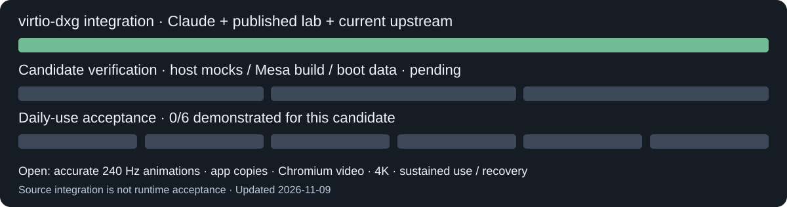

# virtio-dxg integration and desktop performance

Updated November 9, 2026. Branch: `integration/virtio-dxg`. **Source candidate;
new checks have not run. Daily-use stability, accurate 240 Hz animations and
full Chromium acceleration are not established.**

## What is combined

Claude's `virtio-dxg` at `6d3524c34fb360bf6e8662be02892bdd95a966f6`
already descends from our published `windows-nvgpu-lab` at
`1c2dd3b8cd8676076056e44a418216621ac3c2d5`. All that published work is
retained. This integration adds nine official upstream commits through
`95ed4a1` (merge `8271662`), including display/cursor, audio, terminal and
runtime fixes. The `virtio-dxg` branch, `master` and unrelated local work
remain outside the integration changes.

Retained architecture: QEMU/WHPX, the real guest dxg kernel driver over
virtqueues, NVIDIA's host-matched WSL user-mode libraries shared read-only,
Mesa d3d12/Dozen, and the compositor's GPU texture scanout into the existing
SDL window. Official Windows keyboard/mouse handling is retained. No second
input injector, compositor animation override or guest CPU flag workaround
is added. The launcher already uses `-cpu host` and `tryomarchy.render=gpu`
for dxg mode.

## Candidate fixes

| Area | Change | Expected benefit / remaining limit |
| --- | --- | --- |
| Missing/stale animation frames | Mirror writes are queued independently per context, replacing a shared texture dirty bit. | One pending context no longer suppresses another context's flush. This is a source defect, not a confirmed diagnosis of every observed glitch. |
| CPU work in each frame | Up to 16 pending mirrors use a stack list instead of a temporary heap allocation. | Removes that allocation from an ordinary flush; does not remove application `wl_shm` copies. |
| Scanout lifetime | Borrowed textures retain the original scanout owner; weak lookups cannot revive a zero-ref resource; owner fallback propagates to borrowers. | Prevents premature unlink/dangling-owner behavior; driver imports run outside the registry mutex. Full concurrent teardown still needs runtime validation. |
| Completion/error handling | Device-removal sentinel values cannot mean successful fence completion or reclaim; mirror CPU publication requires a successful completion wait. | Prevents publishing incomplete readback and unsafe retirement/retry progress. Other driver-removal and unmap paths remain to audit. |
| Upload failures | Carry forward uploader and constant-buffer ownership guards. | Retains previous failure fixes on the real-kernel path, without carrying over the old private interposer ABI. |
| App churn | Rehash deleted handle-table slots without doubling capacity when the live population is small. | Bounds table growth during repeated open/close cycles; large live populations still grow normally. |
| Guest Mesa | Build actual 26.2.6 with KMS mirrors, zero-copy scanout, Dozen FD ownership and the guards above; pin DirectX-Headers to `adbd6f3`. | The two old 26.2.4 deadlock backports are already upstream. Source `VERSION` is no longer overwritten with the installed system version. |
| Startup consistency | Stage and verify one GLX/EGL/GBM/VA-API/Dozen cohort, library aliases and its recipe before setting the session environment. | A damaged, mismatched or incomplete package is rejected; boot-local files do not replace guest packages. |
| Chromium launch path | Route the installed desktop entry and actions through the same Xwayland/ANGLE GL wrapper as `chromium` in PATH; preserve URLs, arguments and sandbox. | Menus using `/usr/bin/chromium` no longer bypass the wrapper. Custom user desktop entries can still override the installed entry. |

The Chromium wrapper requests GPU rasterization and explicitly selects ANGLE
OpenGL when the session supplies `DISPLAY`. Without `DISPLAY`, or with
`VIRTIO_DXG_CHROMIUM=passthrough` / `--disable-gpu`, it preserves the ordinary
launcher. It does not invent an X display or disable Chromium's sandbox.
`virtio_dxg.chromium=wayland` keeps the browser configured as before.

**Browser video encoding is deliberately not accepted:** Claude's results
report that Mesa VA-API encode removes the D3D12 device on its first frame.
The wrapper uses Chromium's
[`disable-accelerated-video-encode` switch](https://chromium.googlesource.com/chromium/src/+/master/content/public/common/content_switches.cc).
NVENC working in a separate ffmpeg test does not prove Chromium video
acceleration. Decode, WebGL, GPU raster/compositing, sandbox behavior and
codec-specific paths all require evidence from the actual browser.

## Evidence and performance limits

The inherited [results](VIRTIO-DXG-RESULTS.md) report 238 page flips/s at
2496×1407 during a **six-second** trace, roughly 200 fps in a browser test,
and a **180-second** compositor stress sample. Those are useful prior results;
they were not rerun for this candidate and do not prove correct animation,
actual 240 presented frames/s, 4K throughput or daily-use reliability.
The owner reports the desktop works well but still has glitches and missing
animations. That report remains an open regression, not a passed gate.

Two major bottlenecks remain:

1. Applications still use `wl_shm`: GPU readback followed by compositor upload.
   At 3840×2160, one BGRA frame is 31.6 MiB. At 240 updates/s, each full-frame
   copy alone moves 7.4 GiB/s. App/compositor GPU-buffer sharing with explicit
   producer/consumer synchronization is needed before claiming 4K/240 performance.
2. Guest vblank is generated by a timer, not a host presentation clock.
   Raising the requested refresh rate cannot fix drift or prove correct pacing.
   Host-present feedback and measured frame intervals remain necessary.

Cold starts also pay driver/queue creation and file loading costs. The inherited
read-only 9p cache already improves warm library loads; this candidate preserves
it and normal persistent user caches. No background GPU prewarming, forced
memory overcommit adjustment, vCPU over-allocation, disabled animation or
changed Windows display setting is introduced as a speed fix. Near-instant app
launches and CPU speed gains must be measured against the same workload/native
baseline; no universal speedup is claimed here.

## Verification plan and current status

**Not run:** the new CPU fixtures, combined Mesa compile and new boot payload
checks await approval. No GPU, VM, renderer or graphics library has been run
for this integration. Existing successful legacy checks describe their own
commits/profiles, not this new combined Mesa recipe.

Prepared workflow: [virtio-dxg-integration.yml](../.github/workflows/virtio-dxg-integration.yml).
Windows host checks use a mock D3DKMT dispatch table. Linux checks use inert
archive/browser fixtures and extract the actual Mesa mirror/fence/reclaim functions
into CPU substitutes, with an expected failure of the old shared-dirty-bit
, fence-sentinel and reclaim-sentinel code. The combined release build enables X11/Wayland,
GLX/EGL/GBM/GLVND, d3d12/softpipe, VA-API and Dozen, with **two compiler
workers**. Its libraries are packaged and inspected, never loaded. Windows
job limit: 10 minutes; Linux controls/build limit: 45 minutes.

The build receipt records exact source/recipe/SDK and staged-file hashes.
CPU fixture success and compilation are prerequisites for a separately
approved hardware run, not daily-use acceptance.

## Six daily-use acceptance gates

All six remain pending for this candidate:

- Normal installed-account launcher/session flow and preserved official input.
- Correct menus, popovers, workspace/window animations, resizing and effects,
  with host-present timing measured against the 240 Hz target.
- Chromium and multiple app windows through 4K, with real renderer, raster,
  WebGL and video evidence; software fallback is reported explicitly.
- Cold/warm app-launch latency and CPU performance measured with reproducible
  workloads and native baselines, with visible readiness as the endpoint.
- Sustained mixed browsing/apps/video operation with bounded CPU, RAM, VRAM,
  handles and GPU mappings; no host display/driver corruption.
- Tested close, restart, workload failure, timeout and device-removal handling,
  including cleanup and usable recovery.

Full Linux Vulkan, DXR/DLSS/Reflex game execution, NVDEC performance and the
goal of at least 93% native performance are separate outstanding API/workload
requirements. Extension enumeration, an NGX library loading, a compute sample
or NVENC throughput does not establish them.

Local hardware tests require approval for an exact run because the earlier
display incident affected the shared physical driver. An inactive desktop is
not isolation. No driver/display changes or local hardware test are part of
the prepared remote CPU batch.
